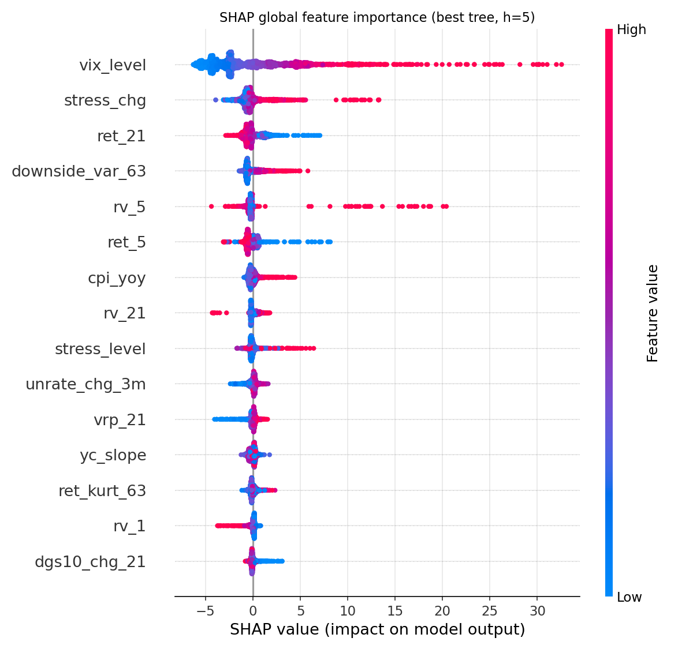
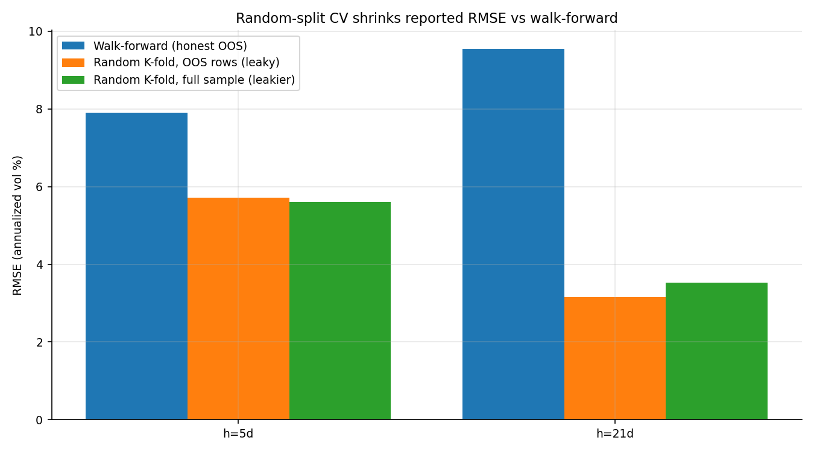
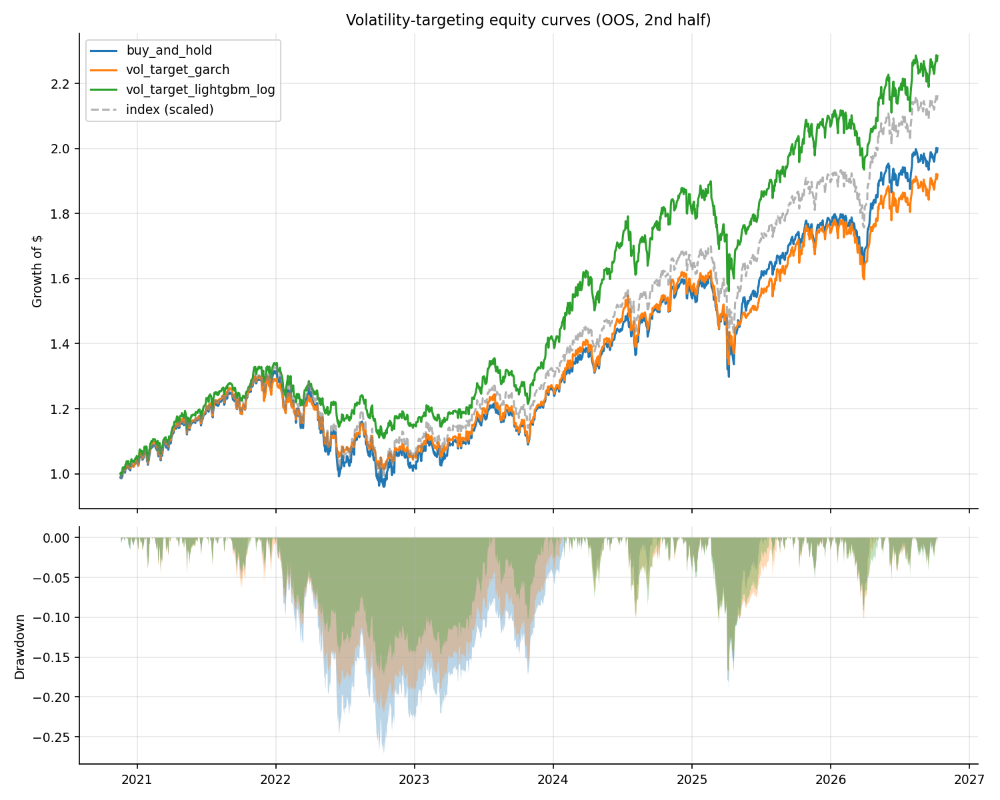

# Can Machine Learning Beat GARCH? A Walk-Forward Benchmark for S&P 500 Volatility Forecasting Using Macro Data

A reproducible quantitative-research project that benchmarks **classical
volatility models** (EWMA, GARCH(1,1)-t, HAR-RV) against **machine-learning
models** (Ridge, Random Forest, LightGBM, LSTM) for forecasting the **future
realized volatility of the S&P 500**, using strict expanding-window
**walk-forward validation**, **Diebold–Mariano** significance testing, an
**economic-value** backtest, SHAP interpretability, and an explicit **leakage
demonstration**.

> **Honest headline result.** ML wins *significantly* at the **weekly (5-day)**
> horizon (Ridge RMSE 7.57 vs GARCH 8.56, DM *p* = 0.0002) but does **not**
> significantly beat classical models at the **monthly (21-day)** horizon. At 21
> days, boosted trees (LightGBM) are in fact *worse* than HAR-RV. GARCH-driven
> volatility targeting gives the best risk-adjusted returns, so ML adds **no
> clear economic value**. ML does **not** uniformly beat GARCH — and we say so.

---

## Table of contents

1. [Overview](#1-overview)
2. [Key results](#2-key-results-all-numbers-generated-by-code)
3. [Figures](#3-figures)
4. [Data sources & provenance](#4-data-sources--provenance)
5. [Quick start](#5-quick-start)
6. [Reproducing the pipeline](#6-reproducing-the-pipeline)
7. [Configuration reference](#7-configuration-reference-configyaml)
8. [Project structure](#8-project-structure)
9. [Methodology summary](#9-methodology-summary)
10. [Metrics glossary](#10-metrics-glossary)
11. [Testing](#11-testing)
12. [Version control & artifacts](#12-version-control--artifacts)
13. [Troubleshooting & FAQ](#13-troubleshooting--faq)
14. [Limitations](#14-limitations)
15. [Honest conclusion](#15-honest-conclusion)
16. [Deliverables checklist](#16-deliverables-checklist)

---

## 1. Overview

| | |
|---|---|
| **Question** | Evaluated honestly, can ML beat GARCH/HAR-RV for S&P 500 realized-vol forecasting using macro + market data? |
| **Target** | Annualized forward realized vol, `RV_h(t) = sqrt((252/h)·Σ r²_{t+1..t+h})·100`, at `h = 5` and `h = 21` trading days |
| **Classical models** | Historical mean, EWMA (λ=0.94), GARCH(1,1)-t (`arch`), HAR-RV (OLS) |
| **ML models** | Ridge, Random Forest, LightGBM, LSTM (PyTorch; degrades gracefully) |
| **Validation** | Expanding-window walk-forward, horizon-length purge/embargo; **no random splits** |
| **Significance** | Diebold–Mariano (Newey-West HAC, Harvey small-sample correction) |
| **Economic value** | Volatility-targeting backtest with transaction costs |
| **Explainability** | SHAP (global importance, beeswarm, calm-vs-crisis) |
| **Tech** | Python 3.11, pandas/numpy/scipy, statsmodels, arch, scikit-learn, LightGBM/XGBoost, SHAP, matplotlib, yfinance, pandas-datareader, PyYAML, pytest, optional torch |
| **Sample** | ^GSPC + ^VIX from 2000-01-01; OOS reported here 2015-01-02 → 2026-10-09 (`--fast`); full config targets 2010 |

---

## 2. Key results (all numbers generated by code)

Out-of-sample (OOS) window actually used in this run: **2015-01-02 → 2026-10-09**
(2,958 trading days). This run used the `--fast` flag (see
[Reproducing the pipeline](#6-reproducing-the-pipeline) for the full 2010-onward
configuration). Lower RMSE / QLIKE and higher R²_oos are better.

### Forecast accuracy (RMSE, %, purely OOS)

| Model      | h = 5d RMSE | h = 5d QLIKE | h = 5d R²_oos | h = 21d RMSE | h = 21d QLIKE | h = 21d R²_oos |
|------------|:-----------:|:------------:|:-------------:|:------------:|:-------------:|:--------------:|
| hist_mean  | 11.078 | 1.941 | 0.000 | 9.899 | 1.664 | 0.000 |
| EWMA       | 9.314  | 1.598 | 0.293 | 9.512 | 1.620 | 0.077 |
| **GARCH(1,1)-t** | 8.559 | 1.496 | 0.403 | 8.916 | 1.435 | 0.189 |
| **HAR-RV**  | 8.150 | 1.547 | 0.459 | 8.304 | 1.467 | 0.296 |
| **Ridge**   | **7.570** | 1.419 | **0.533** | 8.593 | 1.550 | 0.246 |
| **Random Forest** | 7.677 | **1.405** | 0.520 | **8.080** | 1.463 | **0.334** |
| LightGBM    | 7.744 | 1.432 | 0.511 | 9.185 | 1.532 | 0.139 |
| LSTM        | 8.323 | 1.532 | 0.436 | 8.367 | 1.651 | 0.286 |

*Best 5-day forecaster: **Ridge** (RMSE 7.570). Best 21-day forecaster: **Random Forest** (RMSE 8.080).*

### Statistical significance — Diebold–Mariano (positive DM ⇒ model beats benchmark)

| Model | h=5 vs GARCH (p) | h=5 vs HAR (p) | h=21 vs GARCH (p) | h=21 vs HAR (p) |
|-------|:----------------:|:--------------:|:-----------------:|:---------------:|
| Ridge      | **+3.76 (0.0002)** | **+3.36 (0.0008)** | +0.45 (0.656) | −0.58 (0.562) |
| Random Forest | **+2.75 (0.0060)** | **+2.06 (0.039)** | +1.39 (0.165) | +0.71 (0.476) |
| LightGBM   | **+2.45 (0.014)** | +1.60 (0.109) | −0.49 (0.626) | **−2.41 (0.016) ✗ worse** |
| LSTM       | +0.46 (0.643) | −0.38 (0.702) | +0.88 (0.377) | −0.18 (0.859) |

**Read:** at the 5-day horizon Ridge, RF and LightGBM beat GARCH at conventional
significance (DM p < 0.05); Ridge and RF also beat HAR-RV. At the 21-day horizon
**no ML model beats GARCH or HAR-RV significantly**, and **LightGBM is
significantly worse than HAR-RV.**

### Economic value — volatility targeting on the S&P 500

Position = `clip(target_vol / forecast_vol, 0, 1.5)`, rebalanced every 21 days,
5 bps cost per unit turnover. Best ML forecaster at h=21 (Random Forest) chosen.

| Strategy           | Ann. return | Ann. vol | Sharpe | Max drawdown | Ann. turnover |
|--------------------|:-----------:|:--------:|:------:|:------------:|:-------------:|
| Buy & hold         | 11.60% | 17.66% | 0.657 | **−36.1%** | 0.00 |
| Vol-target GARCH   | 10.20% | **14.97%** | **0.682** | **−23.0%** | 0.124 |
| Vol-target RF (ML) | 10.52% | 15.77% | 0.667 | −28.4% | 0.091 |

Vol targeting cuts drawdowns materially; the GARCH-forecast version has the
highest Sharpe and lowest drawdown here — **the ML forecast does not add
economic value over GARCH in this backtest.**

### Leakage demonstration (why random CV is wrong)

Same LightGBM model, random 5-fold CV vs the honest walk-forward RMSE:

| Horizon | Random K-fold RMSE | Walk-forward RMSE | Inflation |
|---------|:------------------:|:-----------------:|:---------:|
| h = 5   | 5.339 | 7.744 | **31.1%** |
| h = 21  | 3.414 | 9.185 | **62.8%** |

A naive random split makes the model look ~31–63% more accurate than it truly is
out of sample. All headline results use walk-forward only.

### Bonus: high-risk regime classifier (next-21d max drawdown > 5%)

| Model    | PR-AUC | Brier | Base rate |
|----------|:------:|:-----:|:---------:|
| Logistic | 0.347 | 0.178 | 0.222 |
| LightGBM | 0.225 | 0.206 | 0.222 |

Modest skill only — PR-AUC barely exceeds the 22.2% base rate, and the tree
model is essentially at base rate. Flagged honestly as a weak bonus module.

---

## 3. Figures

| Figure | Path | What it shows |
|--------|------|---------------|
| SHAP global importance | `results/figures/shap_importance.png` | Which features drive the LightGBM model (VIX dominates) |
| SHAP beeswarm | `results/figures/shap_beeswarm.png` | Per-feature effect direction/magnitude |
| SHAP calm vs crisis | `results/figures/shap_crisis_vs_calm.png` | Top-feature shifts across VIX regimes |
| Leakage | `results/figures/leakage_random_vs_walkforward.png` | Random-split inflation vs walk-forward |
| Strategy | `results/figures/strategy_equity_drawdown.png` | Equity curves & drawdowns |





---

## 4. Data sources & provenance

- **Prices:** S&P 500 (`^GSPC`) and VIX (`^VIX`) daily via `yfinance`
  (⚠️ requires `yfinance >= 1.0`; the legacy 0.1.x line silently returns empty
  frames because Yahoo changed its crumb/cookie API).
- **Macro (FRED, public `fredgraph.csv`, no API key):** DGS10, DGS2, T10Y2Y,
  DFF, UNRATE, CPIAUCSL, DCOILWTICO, BAMLH0A0HYM2, NFCI. Requests use retries +
  exponential backoff, fall back to `pandas_datareader`, and use `fredapi` if
  `FRED_API_KEY` is present. Every download is logged (rows, date range,
  missingness, source used) to `data/raw/download_log.json`.
- **Documented substitution:** the ICE BofA US High-Yield OAS (`BAMLH0A0HYM2`)
  was **truncated by FRED in 2024** and now only serves ~2023+ (16.5% coverage of
  our window). The credit/financial-stress features therefore fall back to the
  **Chicago Fed National Financial Conditions Index (NFCI)**, which has full
  weekly history. The choice is logged in `data/processed/feature_notes.json` and
  described in [`paper/paper.md`](paper/paper.md).
- **Publication-lag control:** monthly series (UNRATE, CPIAUCSL) are shifted
  forward by their release lag (`publication_lag_days`) **before**
  forward-filling, so the model only ever sees data that was genuinely public on
  date *t*.

---

## 5. Quick start

```bash
# 1. Create & install the pinned environment (Python 3.11)
python -m venv .venv && . .venv/bin/activate      # Windows: .venv\Scripts\activate
python -m pip install -r requirements.txt

# 2. Run the whole benchmark end to end (fast smoke run, OOS from 2015)
python run_all.py all --fast

# 3. Read the outputs
#    results/summary.md, results/tables/, results/figures/, paper/paper.md
```

Linux/macOS with `make`: `make install && make all`.

---

## 6. Reproducing the pipeline

The pipeline is a set of CLI modules under `src/`, each reading `config.yaml`.
`Makefile` targets and `run_all.py` stages are equivalent.

| Stage | Make | run_all.py | Modules executed |
|-------|------|-----------|------------------|
| Download | `make data` | `python run_all.py data` | `src.data_download` |
| Build features | `make features` | `python run_all.py features` | `src.data_clean`, `src.targets`, `src.features` |
| Fit & forecast | `make models` | `python run_all.py models` | `src.walkforward` |
| Evaluate | `make evaluate` | `python run_all.py evaluate` | `src.evaluate`, `src.explain`, `src.strategy`, `src.leakage_demo` |
| Report | `make report` | `python run_all.py report` | `src.report` |
| **All** | `make all` | `python run_all.py all` | everything above |

**Common flags** (accepted by every module):
- `--config PATH` — configuration file (default `config.yaml`).
- `--fast` — fewer re-fits and OOS start of **2015** instead of 2010 (a quick
  smoke run, used for the numbers above).
- `--force` — re-download / rebuild even if cached files exist.

> **Full vs fast.** `--fast` keeps a run well under a few minutes by starting the
> OOS window in 2015 and re-fitting GARCH/LSTM less often. The **default
> (non-fast) run uses the full cadence and an OOS start of `2010-01-01`** as
> specified. To reproduce the specification-exact benchmark, run
> `python run_all.py all` (no `--fast`) and regenerate the tables.

---

## 7. Configuration reference (`config.yaml`)

Everything is driven by `config.yaml`; nothing is hard-coded in the scripts.

| Section | Key | Meaning |
|---------|-----|---------|
| `data` | `start_date`, `end_date` | requested range (null end → today) |
| | `tickers` | `sp500: ^GSPC`, `vix: ^VIX` |
| | `fred_series` | FRED ids to download |
| | `monthly_series` / `weekly_series` / `daily_series` | frequency buckets (drive the publication-lag shift) |
| | `hy_min_coverage` | if HY OAS coverage `<` this, substitute NFCI (default 0.80) |
| | `publication_lag_days` | per-series forward shift (UNRATE/CPI 40, NFCI 5) |
| | `request` | `timeout`, `max_retries`, `backoff_factor` |
| `targets` | `horizons` | `[5, 21]` trading days |
| | `regime` | bonus classifier: `max_drawdown_threshold` (0.05), `window` (21) |
| `features` | windows/lags | HAR RV windows, return lags, skew/kurt/downside, VIX/rate/spread/oil/unemp/CPI windows, `use_month_dummies` |
| `models` | `ewma_lambda` | 0.94 |
| | `garch` | `dist: t`, `refit_every: 63` |
| | `lstm` | enabled, epochs, hidden, layers, lr, seq_len, batch, `refit_every: 126`, patience |
| | `ml` | ridge alphas; RF grid; boosting backend (`lightgbm`/`xgboost`) + grid |
| `validation` | `train_initial_years` | ~8-year initial window |
| | `ml_refit_every` | re-fit cadence (21 trading days) |
| | `embargo_days` | `"horizon"` → purge last *h* rows before test |
| | `oos_start` | `2010-01-01` (fast run overrides to 2015) |
| | `cv_splits` | TimeSeriesSplit folds for tuning |
| `evaluation` | `subperiods` | full / calm_2010_2019 / covid_2020 / rate_shock_2022 |
| | `vix_crisis_threshold` | crisis split at VIX > 30 |
| `strategy` | `target_vol`, `leverage_cap/floor`, `rebalance_every`, `transaction_cost_bps`, `initial_capital` | vol-targeting backtest parameters |
| `runtime` | `seeds`, `n_jobs`, `fast` | reproducibility seeds (primary = first), parallelism |

---

## 8. Project structure

```
.
├── config.yaml              # single source of truth for all parameters
├── requirements.txt         # pinned, reproducible environment (Py 3.11)
├── Makefile                 # stage targets (data/features/models/evaluate/report/all)
├── run_all.py               # cross-platform orchestrator (stand-in for make)
├── README.md                # this file
├── .gitignore               # ignores regenerable data/artifacts, keeps docs+results
├── src/
│   ├── data_download.py     # Step 1: yfinance + FRED CSV (retry/fallback/cache/log)
│   ├── data_clean.py        # Step 2: trading-day alignment, leak-safe ffill/lag shift
│   ├── targets.py           # Step 3: forward realized-vol targets + regime flag
│   ├── features.py          # Step 4: leak-free features (all info ≤ t)
│   ├── models_classical.py  # Step 5: hist-mean, EWMA, GARCH(1,1)-t, HAR-RV
│   ├── models_ml.py         # Step 5: Ridge, RF, LightGBM/XGBoost, optional LSTM
│   ├── walkforward.py       # Step 6: expanding-window engine w/ purge & embargo
│   ├── evaluate.py          # Step 7: RMSE/MAE/QLIKE/R²_oos, DM, sub-periods, regime
│   ├── explain.py           # Step 8: SHAP importance / beeswarm / calm-vs-crisis
│   ├── strategy.py          # Step 9: volatility-targeting backtest + costs
│   ├── leakage_demo.py      # Step 6b: random K-fold vs walk-forward inflation
│   ├── report.py            # Step 10: summary.md, key tables, deliverables checklist
│   └── utils.py             # config load, paths, logging, seeding
├── notebooks/
│   ├── 01_eda.ipynb         # data exploration + plots
│   └── 02_results.ipynb     # loads results/, reproduces headline figures
├── data/
│   ├── raw/                 # cached downloads (git-ignored; .gitkeep kept)
│   └── processed/           # clean_daily / targets / features (git-ignored)
├── results/
│   ├── oos_predictions.csv.gz
│   ├── tables/              # metrics, dm, sub-periods, strategy, leakage, shap, regime
│   ├── figures/             # shap_*, leakage_*, strategy_*
│   └── summary.md           # one-page, numbers-only summary
├── paper/paper.md           # short research write-up (real numbers)
└── tests/                   # pytest: no-leakage, alignment, DM sanity
```

---

## 9. Methodology summary

1. **Target.** Forward annualized realized vol `RV_h(t)`, `h ∈ {5, 21}` — a label,
   never a feature.
2. **Features (≤ t).** 21 leak-free predictors: HAR RV components (1/5/21/63),
   lagged returns, 63-day skew/kurtosis/downside semi-variance, VIX level/change,
   variance-risk premium, yield-curve slope, 21-day rate changes, NFCI stress
   level/change, oil return, unemployment change, CPI YoY.
3. **Models.** Classical (hist-mean, EWMA, GARCH-t via fixed-parameter multi-step
   recursion, HAR-RV OLS) and ML (Ridge/RF/LightGBM tuned once on the oldest
   training window via `TimeSeriesSplit`, optional LSTM).
4. **Validation.** Expanding-window walk-forward; purge/embargo of *h* days
   between train end and test start; **no random splits** for headline results.
5. **Evaluation.** RMSE, MAE, QLIKE, OOS R² vs hist-mean; DM tests (Newey-West
   HAC with *h−1* lags, Harvey correction); sub-period & VIX-regime breakdowns.
6. **Economic value.** Vol targeting (`target_vol / forecast_vol`, capped 1.5×,
   monthly rebalance, 5 bps turnover cost).
7. **Explainability.** SHAP for the boosted-tree model, calm vs high-VIX.
8. **Leakage demo.** Quantifies random-CV optimism vs walk-forward.

---

## 10. Metrics glossary

| Metric | Definition / note |
|--------|-------------------|
| **RMSE** | Root-mean-square error of vol forecasts (in %). Penalizes large misses. |
| **MAE** | Mean absolute error (in %). Robust relative to RMSE. |
| **QLIKE** | `ln(f²) − ln(a²) + a²/f²` — robust, asymmetric volatility loss; not minimized by the conditional mean and scale-invariant. Lower is better. |
| **R²_oos** | `1 − SSE_model / SSE_hist-mean` vs the historical-mean benchmark. >0 beats the benchmark out of sample. |
| **Diebold–Mariano** | Test of the loss differential between model and benchmark. **Positive DM ⇒ model has lower loss (is better).** p-value is two-sided. |
| **Sharpe** | Annualized excess return / annualized volatility (rf proxy configurable). |
| **Max drawdown** | Deepest peak-to-trough decline of the equity curve. |
| **Turnover** | Average annual one-way weight change (drives transaction costs). |
| **PR-AUC / Brier** | Precision-recall area under curve / mean squared probability error for the regime classifier. |

---

## 11. Testing

```bash
python -m pytest -q
```

The suite (in `tests/`) covers:

- **`test_no_leakage.py`** — perturbs *all* observations after date *t* and
  asserts that features at *t* are **unchanged** (proves no forward leakage), and
  that the realized-vol target alignment is correct.
- **`test_dm.py`** — sanity-checks the Diebold–Mariano implementation: sign
  convention (a strictly better model ⇒ positive DM), identical-model ⇒ DM ≈ 0,
  and HAC-variance behaviour on overlapping targets.
- `conftest.py` — puts the repo root on `sys.path` and shares fixtures.

Current status: **8 passed** (fast, no network needed once data is cached).

---

## 12. Version control & artifacts

- **`.gitignore` keeps the repo light and reproducible.** Regenerable heavy
  artifacts are **not** committed: `data/raw/*`, `data/processed/*`, the
  prediction panel (`results/oos_predictions.csv.gz`, `*.gz`), intermediate
  backtest dumps (`results/bt_*.csv`), all `*.log`, caches, and venvs.
  `.gitkeep` placeholders preserve the (empty) data directories.
- **What *is* committed:** source, `config.yaml`, `requirements.txt`, `Makefile`,
  `run_all.py`, the two notebooks, `paper/`, `tests/`, `results/summary.md`, and
  the **deliverable** tables & figures (`results/tables/*.csv|md|json`,
  `results/figures/*.png`) that the README and paper quote.
- **Regenerate everything from scratch:** `python run_all.py all` (see
  [Reproducing the pipeline](#6-reproducing-the-pipeline)).
- **Secrets:** never commit `FRED_API_KEY` or a `.env`; they are ignored.

---

## 13. Troubleshooting & FAQ

| Symptom | Cause / fix |
|---------|-------------|
| `^GSPC` download returns empty | You have `yfinance` 0.1.x. Install `yfinance>=1.0` (pinned in `requirements.txt`). |
| A FRED series fails / times out | Automatic retry → `pandas-datareader` fallback. If it still fails, run again; the cache resumes. Set `FRED_API_KEY` to use `fredapi`. |
| `BAMLH0A0HYM2` has ~16% coverage | Expected — FRED truncated it in 2024. NFCI substitution kicks in automatically (documented). |
| Run takes too long | Use `--fast` (OOS from 2015, coarser GARCH/LSTM re-fits). |
| `ImportError: torch` | Optional. The LSTM is skipped gracefully; everything else runs. |
| LSTM column looks empty | Check the contiguous-window predict path in `walkforward.py`; the fast smoke test asserts non-NaN coverage. |
| `pytest` can't import `src` | Run from the repo root; `tests/conftest.py` adds the root to `sys.path`. |
| Want the exact 2010-onward numbers | `python run_all.py all` (no `--fast`), then re-open `results/summary.md`. |

**FAQ — why is OOS 2015 and not 2010 in these numbers?** The README tables come
from a `--fast` smoke run (2015 start) for speed. The full configuration
(`oos_start: 2010-01-01`) is the specification-exact run; regenerate it with
`python run_all.py all`.

---

## 14. Limitations

- **One asset, one proxy.** A single index and a rolling-std realized-vol proxy;
  results need not generalize to other markets or to high-frequency RV.
- **Fast-mode scope for these headline numbers** (OOS 2015+, coarser re-fits);
  the full run extends to 2010 and re-fits more often.
- **Credit proxy substitution** (NFCI for the FRED-truncated HY spread) changes
  the economic interpretation of the `stress_*` features.
- **ML ≠ uniformly better.** GARCH/HAR remain very strong, especially at the
  monthly horizon; the LSTM is under-tuned for runtime reasons.
- **Backtest realism:** 5 bps costs, monthly rebalancing, no slippage/funding
  spreads; leverage capped at 1.5×.

---

## 15. Honest conclusion

Machine learning **does** beat GARCH and HAR-RV **at the weekly horizon** with
statistical significance, driven mainly by the VIX level, financial-stress
changes and recent returns (SHAP). **At the monthly horizon it does not** —
classical HAR/GARCH are as good or better, and boosting degrades. There is no
evidence here that ML forecasts add economic value over GARCH volatility
targeting. The project's real methodological takeaway is the **31–63% accuracy
inflation caused by random-split leakage** versus honest walk-forward validation.

---

## 16. Deliverables checklist

Auto-generated by `python -m src.report` (last run — all **PASS**):

```
[PASS] config.yaml            [PASS] Makefile               [PASS] README.md
[PASS] requirements.txt       [PASS] paper/paper.md         [PASS] notebooks/01_eda.ipynb
[PASS] notebooks/02_results.ipynb                           [PASS] results/summary.md
[PASS] results/tables/main_metrics.csv     [PASS] results/tables/dm_tests.csv
[PASS] results/tables/strategy_performance.csv
[PASS] results/tables/leakage_comparison.csv
[PASS] results/figures/shap_beeswarm.png   [PASS] results/figures/strategy_equity_drawdown.png
[PASS] results/figures/leakage_random_vs_walkforward.png
```

Related deliverables: [`paper/paper.md`](paper/paper.md),
[`results/summary.md`](results/summary.md).

---

*Research only — not investment advice. Past results do not guarantee future
results.*
